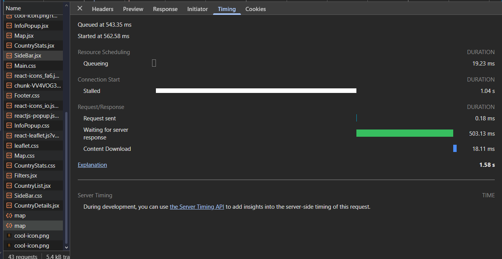

### Adding Browser Caching to map data

**Lead**: Jaidan 

Each time the site loads the map, it takes a second or two to load all of the map data and for leaflet to build everything. I think that half of this problem can be solved by caching the large amounts of country data on the browser side:

After applying caching headers: 

Link: <!-- gitlab url to specific lines of code -->