# Performance of Travel Lens

## Introduction and Methodology

**Candy:** 
- Browser: Google Chrome version 142.0.7444.163
- Device: Laptop
- OS: Windows 11
- Width/Height of Viewport: 1920x1080

**Yuliia:**
- Browser: Google Chrome (v142.0.7444.163)
- Device: Desktop 
- OS: Windows 10
- Width/Height: 2195x1235 (based on `window.screen` output)

## Baseline Performance

**Lighthouse Initial Diagnostics:**
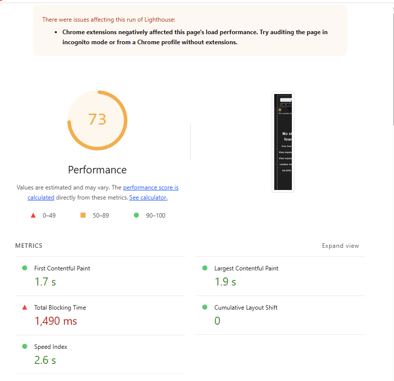
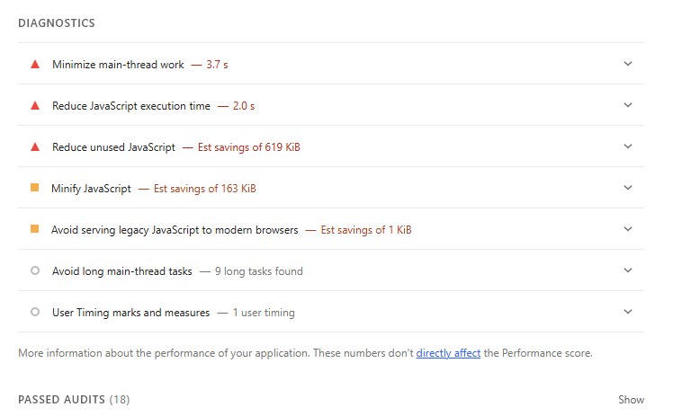

## Summary of Changes 

### Change 1
**Lead:** Candy   
**Link:** [Link to implementation of dynamic import and React.lazy](https://gitlab.com/dawson-cst-cohort-2026/520/section1/teams/Team-D13/520-project-seto-tran-skrypnichenko/-/blob/candy/performance/improvement_01/client/src/components/InfoPopup.jsx#L6-28)  
**Description of change:** I thought of using dynamic import/React.lazy to reduce the “Total blocking time” and the “Minimize main-thread work”.
To do so, I chose to make the InfoPopup content a dynamic import that only loads the PopupContent.jsx when on demand (when user clicks on the icon itself of the popup). By moving the popup content into a separate file and wrapping it with ` <Suspense> ` , the component is only loaded when the user clicks the info icon. This means the JS for the popup is not evaluated during initial load, which helps the main thread remain more responsive.
- **TBT** decreased significantly from 1490ms → 500ms.
- **Minimize main-thread work** decreased slightly from 3.7s → 3.5s.
- **Reduce unused JS** increased from 619 KiB → 752 KiB.
    - **Explanation**: After lazy loading, more JS was deferred until on-demand, so Lighthouse detects more of the JS as “unused” during the initial load.

**After dynamic import diagnostics:**
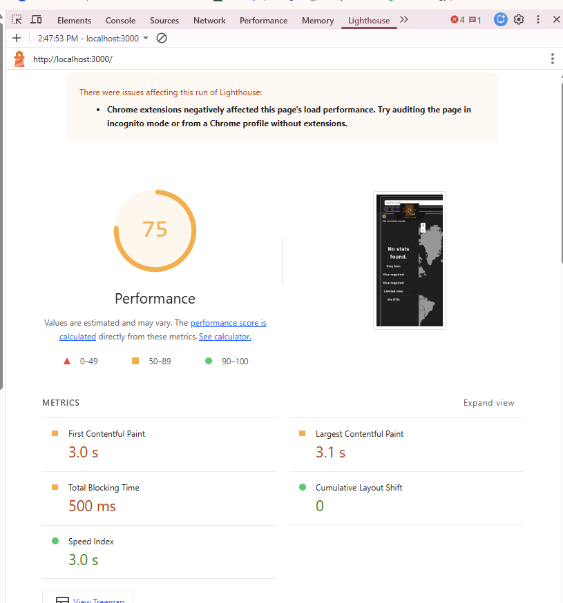
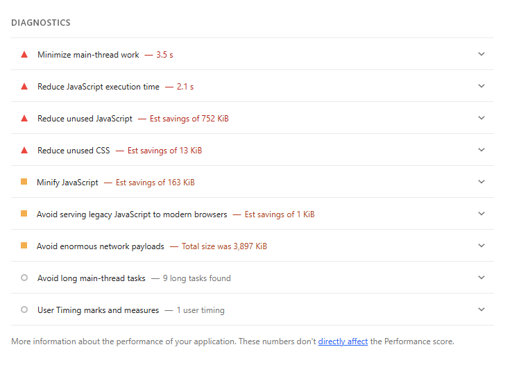

### Change 2
**Lead:** Candy 
**Link:** [Link to implementation of server compression](https://gitlab.com/dawson-cst-cohort-2026/520/section1/teams/Team-D13/520-project-seto-tran-skrypnichenko/-/blob/candy/performance/improvement_02/server/app.js?ref_type=heads#L6-10) 
**Description of change:** Seeing that we had a warning about "Avoid enormous network payloads", I decided to use server compression so that it compresses the response before being sent to the client. After adding the compression, the warning disappeared. Compressing the server means that now it compresses the responses using gzip, which reduces the payload sizes sent over the network. In addition, it also improved the first contentful paint (FCP) and the largest contentful paint (LCP):
- **FCP** decreased from 2.9s -> 1.7s
- **LCP** decreased from 3.0s -> 1.8s
Since now the response are smaller/compressed, it arrived faster. Hence, this allow the browser to start parsing and rendering sooner (FCP) while also allowing the page to paint faster (LCP).

**After compression diagnostics:**
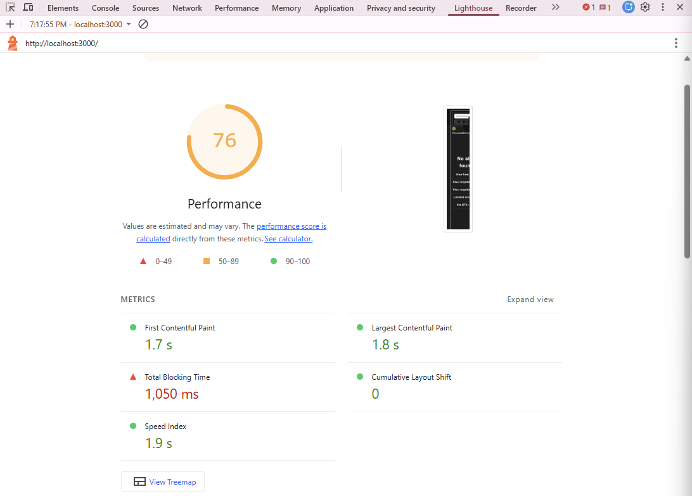
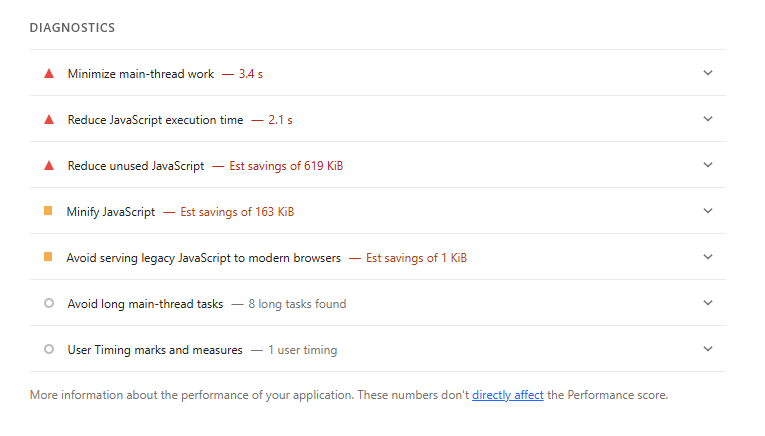
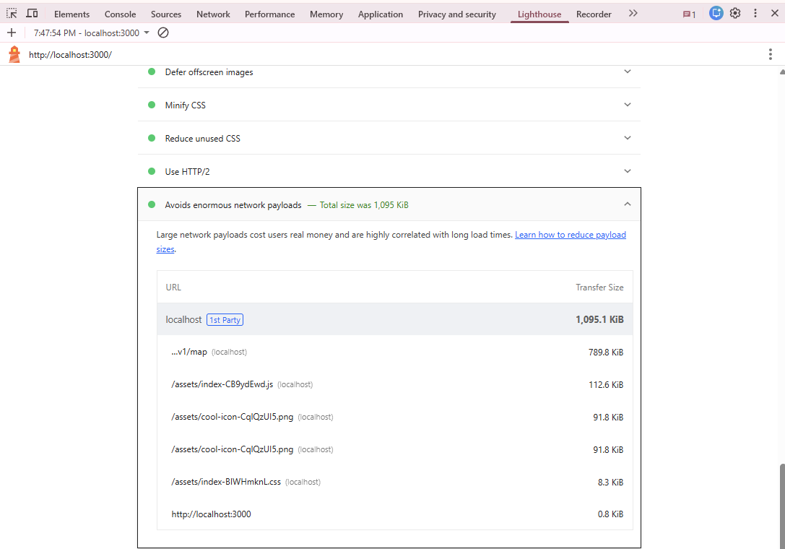

### Change 3

Lead: Yuliia  
Link: [Link to server side caching](https://gitlab.com/dawson-cst-cohort-2026/520/section1/teams/Team-D13/520-project-seto-tran-skrypnichenko/-/merge_requests/45/diffs) 
**Description of change:** When launching our web application, we can notice that the map takes some time to appear. This happens because the server needs to query the database, retrieve the coordinate data, process it, and then send the response back to the client. This entire process repeats for every user, even though the server is always fetching the same static data. To reduce this unnecessary process, I propose implementing server-side caching. With caching, the server can store the processed map data in memory and return it immediately without querying the database each time. This will significantly speed up the initial map load time and reduce unnecessary requests to the database.

In this report from Performance DevTools, we can see that the critical path latency is around 3 seconds, which is quite high. Caching the coordinates, needed for React Leaflet to render the map, will help eliminate unnecessary latency.

As a result, the load time decreased by 1.34 seconds, almost half of what it was before. This happened because the server no longer made unnecessary requests to the database.

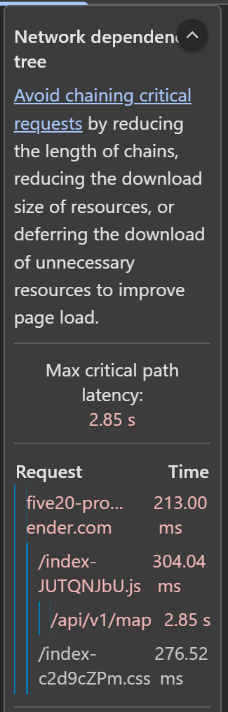
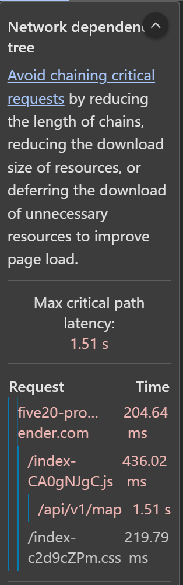

Note: After my first merge request, an error occurred, and the branch mentioned above contains the corrected version.

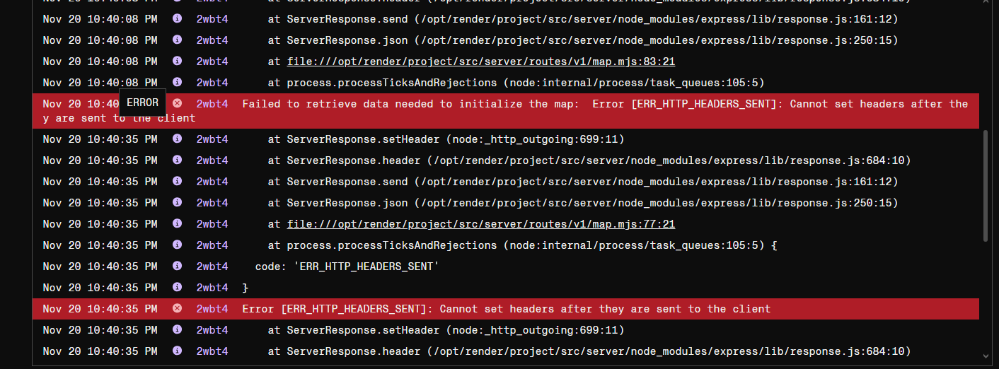

### Change 4

Lead: Yuliia  
Link: [Link to logo preload](https://gitlab.com/dawson-cst-cohort-2026/520/section1/teams/Team-D13/520-project-seto-tran-skrypnichenko/-/merge_requests/48) 
**Description of change:** The WebPageTest shows a warning suggesting that we could preload content for the page. In this case, to at least reduce rendering load because the map requires significant resources and we could use preload on the image to make it easier for the browser to handle. 
*No significant improvements are expected.*

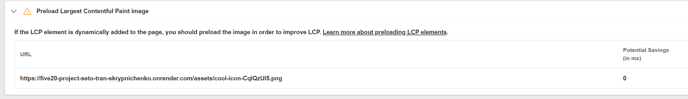
;

## Conclusion

**Candy:** I can see that the server compression had the greatest impact, considering that even after redoing multiple times the Lighthouse report, the result stayed consistent (warning about "Avoid enormous network payload" disappeared) Also, I can also see from the decreased times in both FCP and LCP. From this experience, I learned that using lazy loading alongside dynamic import reduces the Total Time Blocking (TBT) and the main-thread work, and that server compression can significantly improve the FCP and LCP by sending smaller responses over the network. In addition, I did not know how much impact one aspect changing can improve multiple Lighthouse metrics.

**Yuliia:** From my observations, I can note that server-side caching is really useful, considering that I was able to reduce load time by half. It's not perfect, since my computer (the client) still had to contact the host, which then contacted the server, but I was still able to decrease latency, thereby improving the user experience. Also, I had to use return to solve an issue with attaching headers, because without it the function didn't stop executing. I figured this out through my debugging and research. I also got some practice using preload. It tells the browser which resources should be loaded before displaying the page to the user.