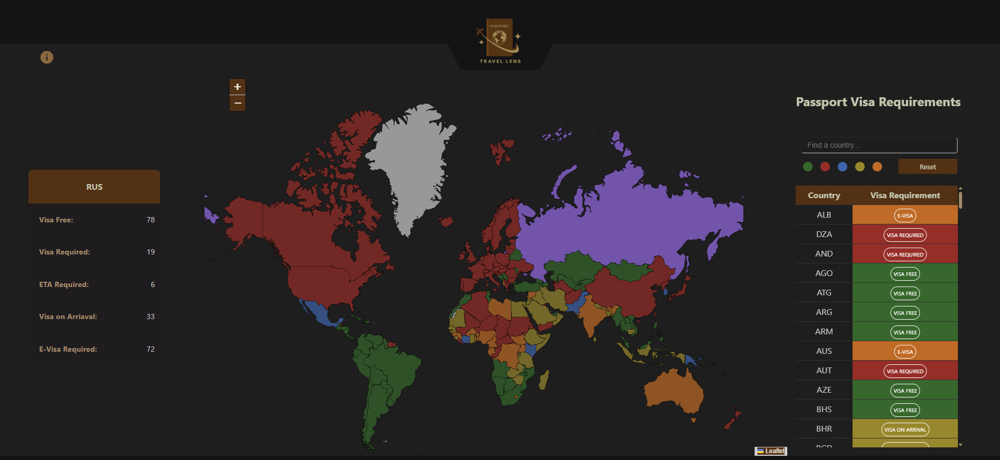

# Travel Lens 

Express + React app

## Description: 
[Travel Lens](https://five20-project-seto-tran-skrypnichenko.onrender.com/) is a web-based application that shows the safety index of countries and the travel/visa requirements between them. The interface has three main sections:
- Stats component (left): Summarizes the number of countries requiring each visa type.
- Map component (center): Colors countries based on visa type; clicking a country shows details.
- Sidebar component (right): Lists countries with their visa requirements; you can filter by visa type color or search for a specific country. Clicking a country in the list shows its safety index and annual tourist numbers.

## Screenshot



## Requirements
- Node.js >= 18.x
- npm >= 9.x
- MongoDB Atlas account (or local MongoDB)
- Modern web browser (Chrome, Firefox, Edge)
- Internet connection (to fetch external APIs / datasets)


## Structure
- `/client` – React frontend (components, styles, assets)
- `/server` – Express backend (routes, database connection, data, tests, modules)
- `/screenshots` – images used in README.md and Performance.md
- `/planning` – project planning materials:
   - `/wireframes` – contains the design mockups:
    - `desktop.png` – desktop layout wireframe
    - `mobile.png` – mobile layout wireframe
  - `proposal.md` – initial project proposal

## Setup

To install all the dependencies and build the React app run:

```
npm run build
```

## To run the app

### Just the client

```
cd client
npm run dev
```

### Just the server

```
npm run start # from project root
```

### Client and Server
in the root of the project, open two terminals, one for the server and one for the client:

# Terminal 1 - Server
```
npm run start # from project root
```

# Terminal 2 - Client
```
cd client
npm run dev
```

## Deployment
The Travel Lens app is deployed on Render:
- https://five20-project-seto-tran-skrypnichenko.onrender.com/


### Re-deploying the app
Whenever you make updates to your project:
1. Push changes to the branch you configured on Render (e.g., main or staging):
```
git add .
git commit -m "Update feature / fix bug"
git push origin staging
```
2. Render automatically rebuilds and restarts the web service using your build and start commands.
3. If you need to manually trigger a deployment:
    - Go to your Render dashboard → Web Service → Manual Deploy → select the commit to deploy.
4. Ensure any new environment variables are added in Render under Environment Variables before redeploying.
5. Update MongoDB Atlas IP Access List:
    - Once deployed, add the Render production web server's static outbound IP addresses to MongoDB Atlas.
    - Remove any rules allowing development IP addresses to connect.
    - In Render: Web Service → Settings → Connect → copy the outbound IP addresses.
    - In MongoDB Atlas: Security → Network Access → Add these IPs to the IP Access List.

## Attributions:
### Data Sources:
 - [Passport Index](https://github.com/ilyankou/passport-index-dataset)
 - [Safety Index](https://www.kaggle.com/datasets/romanlisachov/safety-index-for-the-last-5-years)
 - [Tourism](https://www.kaggle.com/datasets/imtkaggleteam/tourism?resource=download&select=17-+international-same-day-visitors-per-1000-people.csv)
 - [GeoJSON](https://geojson-maps.kyd.au/?utm_source=self&utm_medium=redirect)

### Libraries & Tools:
 - Express.js
 - MongoDB/MongoDB Atlas
 - React + Vite
 - Node.js
 

