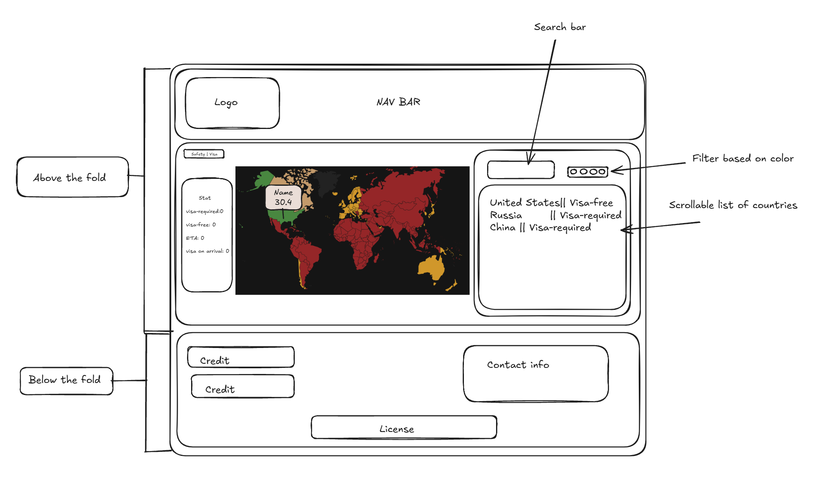
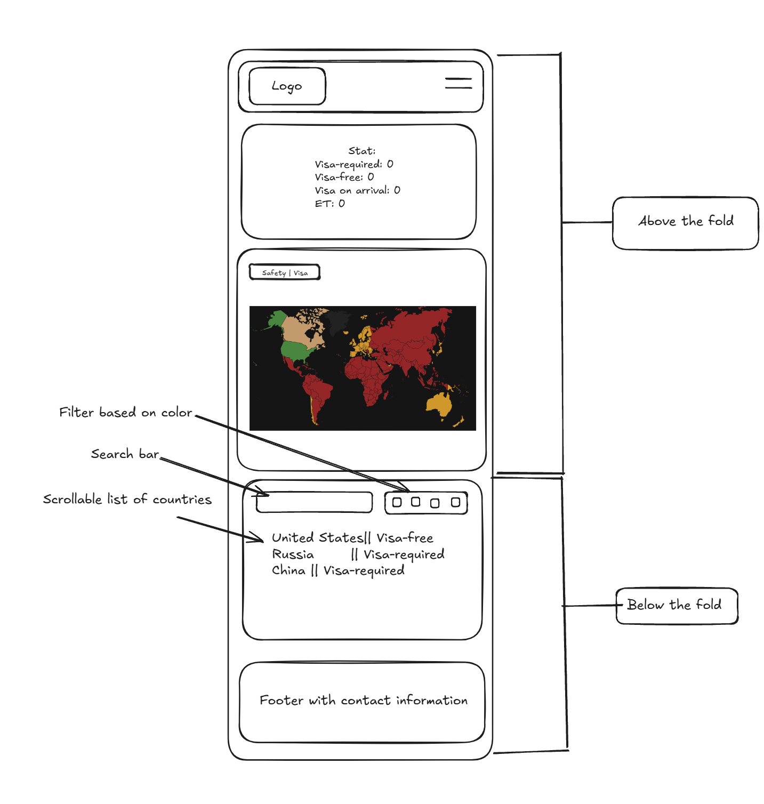

## Travel Lens 

## Data

This project uses four datasets: 

**[Passport Index](https://github.com/ilyankou/passport-index-dataset)**
This dataset shows visa relationships between countries. Each row represents a passport, and columns represent destination countries. This dataset indicates the visa status. We use it to highlight countries on the map based on visa status. 

**[Safety Index](https://www.kaggle.com/datasets/romanlisachov/safety-index-for-the-last-5-years)**
This dataset ranks countries by safety index represented by a numerical score. In this case, the higher score means a safer country. We use it to display information in the country details component, alongside the tourism data.

**[Tourism](https://www.kaggle.com/datasets/imtkaggleteam/tourism?resource=download&select=17-+international-same-day-visitors-per-1000-people.csv)**
This dataset tracks annual inbound tourist arrivals for countries over the years 1995 up to 2021. Each row represent a country with its respective columns such as the entity (the country name itself), their country code, the year and the inbound arrivals. We use it to display information in the country details component, alongside the safety data.

**[GeoJSON](https://geojson-maps.kyd.au/?utm_source=self&utm_medium=redirect)**
This dataset is used to represent geographic features (countries) in a structured format so they can be accurately displayed on the map.

For more technical details, see [Choose Data Issue](https://gitlab.com/dawson-cst-cohort-2026/520/section1/teams/Team-D13/520-project-seto-tran-skrypnichenko/-/issues?show=eyJpaWQiOiIxIiwiZnVsbF9wYXRoIjoiZGF3c29uLWNzdC1jb2hvcnQtMjAyNi81MjAvc2VjdGlvbjEvdGVhbXMvVGVhbS1EMTMvNTIwLXByb2plY3Qtc2V0by10cmFuLXNrcnlwbmljaGVua28iLCJpZCI6MTc0NTY2NDQzfQ%3D%3D)


## API

This endpoint returns general information about all countries. It will be used to initialize the map and to display popups with safety index and the country name when hovering over each country.  
```
/api/countries 
```
Output: 
```
[
    { "country": "Costa Rica", "iso_a3": "CRI", "safety_index": 72.3 },
    { "country": "France", "iso_a3": "FRA", "safety_index": 78.3 }
]
``` 

This endpoint returns detailed information for a specific country, including visa requirements for selected country. 
```
/api/visa-data/:iso
```
Output: 
```
{
   "coutry": "France",
   "iso_a3": "FRA",
   "safety_index": 78.3,
   "visa_relations": [
        { "destination" : "Italy", "type": "visa free" },
        { "destination" : "Spain", "type": "visa free" }
   ]
}
```

This endpoint returns all countries where a visa status applies for a given country. The :iso parameter is the ISO code of the country, and :type is the visa type (e.g., "visa-free", "e-visa").
```
/api/:iso/visa-status/:type
```
Output:
```
{
  "message": "success",
  "data": [
    {
      "from": "FRA",
      "requirement": [
        { "destination": "Italy", "requirement": "visa-free" },
        { "destination": "Spain", "requirement": "visa-free" }
      ]
    }
  ]
}


```
This endpoint returns the visa requirement from one country to another. :from is the origin country ISO code, and :to is the destination country ISO code.
```
/api/visa-data/:from/:to
```
Output:
```
{
    "from": "FRA",
    "to": "ITA",
    "visaRequired": "visa-free",
}
```
This endpoint retrieves the basic geographic data needed to render the map, including each country's name, ISO code, and coordinates. It is typically used to initialize the map and position countries correctly.
```
GET /api/map
```
Response:
```
[
    { 
        "properties": { "name": "Albania", "iso_a3": "ALB" },
        "geometry": { "type": "Polygon", "coordinates": [...] }
    },
    { 
        "properties": { "name": "France", "iso_a3": "FRA" },
        "geometry": { "type": "Polygon", "coordinates": [...] }
    }
]
```

*Note:* In this case, in our endpoints, we will try to combine 3 datasets mentioned in [Data](#data) and [GeoJSON](#dependencies) file. The presence of GeoJSON file is mandatory when creating an interactive map.

## Visualizations 
The project uses an interactive world map to show information from the passport index , the safety index, and the tourism datasets
The goal is to help user to visually explore how safe each country is and how freely its citizens can travel around the world.

1. **World Map Overview**
    - The map uses GeoJSON data to display all countries 
    - Each country is a clickable region 
    - On the first load, the map is colored based on safety index
    - *This gives and overview of safety levels across different regions* 

2. **Left Side Panel**
     - When the user clicks on a country, additional information is displayed in the left side panel. 
     - This panel contains visa-related statistics of that selected country, such as the visa-required, the visa-free, the ETA counts, and the other visa-status.

3. **Right Side Panel**
    - When the user clicks on a country, additional information is displayed in the right side bar panel.
    - This panel contains a list of countries that citizens of the selected country can visit with a specific visa status.
    - Based on visa status, countries on the map are colored differently (see **[Functionality]**(#functionality) for more details)
    - The user can filter through the results by using the provided search bar, while also using the 4 filter buttons. 
    - When the user clicks on a country listed, it displays an accordion-style expand/collapse animation where it provides tourism information and safety index of that specific country.


*Note:* it's possible that we'll implement the following additional feature 
- A toggle button next to map that allows the user to switch between two views: 
    - Safety index - colours represent safety levels
    - Visa View - colours represent visa requirements (visa-free, e-visa, etc)

## Views
The following image is a wireframe of how our application will look like. It represent the desktop version of our design, showing the layout and approximate placement of key elements such as navigation bar, interactive map, statistics column, side panel and footer with contact information. 



This image illustrates the mobile version of our application. It provides visual demonstration of how our initial layout adapts to smaller screens, while still maintaining the core features. 


1. **Desktop**
    - *Above the fold:*  
        - Navigation bar with project logo 
        - in case React Router is implemented, it will also display different routes/pages (e.g. about us, etc)
        - Interactive world map  
        - Statistics column showing the number of visa-free, e-visa, visa-required, ETA, countries
        - Side panel with a scrollable list of countries 
    - *Below the fold:* 
        - Footer with contact infomation, licensing, etc

2. **Mobile**
    - *Above the fold:*  
        - Navigation bar with project logo
        - in case React Router is implemented, it will also display different routes/pages (e.g. about us, etc) in a collapsible hamburger style
        - Statistics column showing the number of visa-free, e-visa, visa-required, ETA, countries
        - Interactive world map  
    - *Below the fold:* 
        - Side panel with a scrollable list of countries 
        - Footer with contact infomation, licensing, etc


## Functionality
- The user *clicks* on a country displayed on the map
- Get ISO (short code for that country, e.g. United States = USA) from GeoJSON 
- Using the passport index, find all the countries to which citizens can travel and with what *visa type*
- Based on the visa data, *highlight the countries* using the following colours: 
    - *green* to represent *visa-free* 
    - *blue* to represent *e-visa*
    - *red* to represent *visa-required*
    - *yellow* to represent *eta* 
- Hovering over specific country on a map displays the safety index in a pop-up window 


## Features and Priorities
- **Core Features/High Priority**
    - **API** 
        - API defined with 3 endpoints described in *[API]*(#api) section
    - **Interactive Map**
        - Displays all the countries on the interactive map using GeoJSON data
        - Each country is *clickable* and *hoverable*
        - The map dynamically updates based on the selected views 
    - **Side Panel** 
        - Appears only when the user clicks on a specific country
        - Displays a scrollable list of countries with their visa status, represented by different colors as on the map  
    - **Popup** 
        - Displayed when hovering a specific country 
        - Display the name of the country and its safety index 
    - **Toggle Button**
        - Allows users to switch between Safety Index and Visa views on the map 

- **Optional Features/Lower Priority**
    - **React Router**
        - Use this library to extend the application and create multiple routes 
        - The following is just an example and we do **NOT** guarantee the implementation of this functionality: 
            - *main.jsx* displays the main interactive map   
            - *about.jsx* displays an additional view containing information about the project and our team
    - **UI Polishing**
        - Improve the UI styling
    - **Add a Search Bar to the Side Panel**
        - Allows users to search for countries by name in the list
        - Adds the option to sort countries by visa status 


## Dependencies
1. [React-Leaflet](https://react-leaflet.js.org/)
    - Used to create an interactive map 
    - Provides necessary components to visualize our data 
    - Enables user interactions
2. [GeoJSON](https://geojson-maps.kyd.au/?utm_source=self&utm_medium=redirect) 
    - Provides geographic boundaries of all countries
    - Associates countries with names and ISO code 
    - Used by React-Leaflet to visualize countries on the map and link them with passport and safety index 